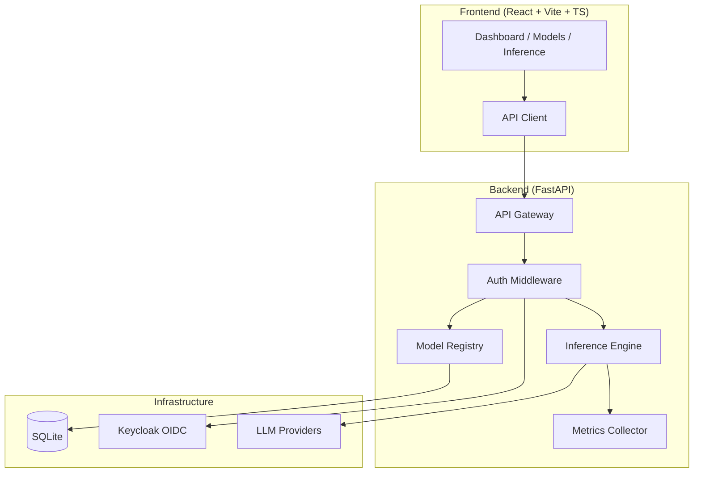

# Lumen Foundry | Ryan Vo | AI & Machine Learning

> Work in progress. This checkpoint may be incomplete or fail tests. See PLAN.md and STATUS.md before use.


A high-throughput and memory-efficient inference and serving engine for LLMs, built with FastAPI and React.

## Problem

Running large language models efficiently requires optimizing memory usage, throughput, and latency across diverse hardware. Existing solutions often sacrifice flexibility for performance or require complex operational overhead. Lumen Foundry provides a developer-focused platform for managing, serving, and monitoring LLM inference workloads with a clean API and real-time dashboard.

## AI/ML Approach

Lumen Foundry implements a **modular inference engine** with:

- **Model Registry**: Centralized model management with versioning, configuration, and metadata
- **Streaming Inference**: Server-Sent Events (SSE) for real-time token streaming with configurable parameters
- **Performance Monitoring**: Real-time metrics collection (latency, throughput, token counts, GPU utilization)
- **Extensible Architecture**: Provider-agnostic LLM integration supporting OpenAI-compatible, Anthropic, Gemini, and Ollama endpoints

The core domain engine handles request routing, parameter validation, response streaming, and metrics aggregation without requiring external LLM keys for development (demo mode with mock engine).

## Intended Users

- **ML Engineers** deploying and benchmarking LLMs
- **AI Researchers** comparing model performance across configurations
- **Platform Teams** building internal LLM serving infrastructure
- **Developers** integrating LLM capabilities into applications

## Architecture



## Features

### Core Workflows
1. **Model Management**: Register, configure, and version LLMs with metadata (max length, default params, active status)
2. **Streaming Inference**: Run inference with real-time token streaming via SSE, configurable sampling parameters
3. **Performance Monitoring**: Real-time dashboard with request counts, token throughput, latency percentiles

### Technical Highlights
- **FastAPI** backend with async SQLAlchemy, Pydantic v2, structured logging
- **React 18 + TypeScript + Vite** frontend with Zustand state management
- **Keycloak OIDC** authentication with PKCE, realm roles (admin/operator/viewer)
- **SQLite** persistent storage with async migrations
- **Docker Compose** orchestration with health checks
- **Comprehensive test suite** (pytest + vitest)

## Quick Start

### Prerequisites
- Docker & Docker Compose
- Or: Python 3.12, Node 24, Keycloak 26

### Using Docker Compose (Recommended)

```bash
# Clone and navigate
cd lumen-foundry-ryan-vo

# Start all services
docker compose up -d

# View logs
docker compose logs -f

# Access services
# Frontend: http://localhost:5173
# Backend API: http://localhost:8000
# API Docs: http://localhost:8000/docs
# Keycloak: http://localhost:8080 (admin/admin)
```

### Local Development

**Backend:**
```bash
cd backend
python -m venv .venv
source .venv/bin/activate
pip install -r requirements.txt
cp ../.env.example .env
# Edit .env as needed
python -m uvicorn app.main:app --reload --port 8000
```

**Frontend:**
```bash
cd frontend
npm install
npm run dev
# Runs at http://localhost:5173
```

**Keycloak (optional for demo mode):**
```bash
docker run -p 8080:8080 \
  -e KC_BOOTSTRAP_ADMIN_USERNAME=admin \
  -e KC_BOOTSTRAP_ADMIN_PASSWORD=admin \
  quay.io/keycloak/keycloak:26.0 start-dev
```

### Demo Mode

The application runs in **demo mode** by default (`DEMO_MODE=true`), which:
- Uses a mock inference engine (no LLM API keys required)
- Accepts any login credentials
- Creates a mock JWT for session management
- Binds only to localhost (refused in production)

## API Reference

### Health
- `GET /api/v1/health` - Service health status
- `GET /api/v1/health/ready` - Readiness probe
- `GET /api/v1/health/live` - Liveness probe

### Models
- `GET /api/v1/models` - List models (paginated, filterable)
- `POST /api/v1/models` - Register new model
- `GET /api/v1/models/{id}` - Get model details
- `PATCH /api/v1/models/{id}` - Update model
- `DELETE /api/v1/models/{id}` - Delete model

### Inference
- `POST /api/v1/inference` - Run inference (streaming or non-streaming)
- `GET /api/v1/inference/models/{id}/metrics` - Model performance metrics
- `GET /api/v1/inference/stats` - Global inference statistics

**Inference Request:**
```json
{
  "model_id": 1,
  "prompt": "Your prompt here",
  "temperature": 0.7,
  "max_tokens": 512,
  "stream": true,
  "top_p": 0.9,
  "top_k": 50,
  "stop": ["\\n\\n"],
  "presence_penalty": 0.0,
  "frequency_penalty": 0.0
}
```

**Streaming Response (SSE):**
```
event: token
data: {"token": "Hello", "token_count": 1}

event: token
data: {"token": " world", "token_count": 2}

event: done
data: {"finish_reason": "stop", "usage": {...}, "latency_ms": 123.4}
```

## Configuration

| Variable | Description | Default |
|----------|-------------|---------|
| `ENVIRONMENT` | deployment environment | `development` |
| `DATABASE_URL` | SQLAlchemy async URL | `sqlite+aiosqlite:///./data/lumen.db` |
| `KEYCLOAK_URL` | Keycloak base URL | `http://localhost:8080` |
| `KEYCLOAK_REALM` | Keycloak realm name | `lumen-foundry` |
| `KEYCLOAK_CLIENT_ID` | OIDC client ID | `lumen-frontend` |
| `KEYCLOAK_CLIENT_SECRET` | OIDC client secret | *(required for production)* |
| `LLM_PROVIDER` | LLM provider type | `openai-compatible` |
| `LLM_MODEL` | Default model name | *(empty)* |
| `LLM_BASE_URL` | Provider base URL | *(empty)* |
| `LLM_API_KEY` | Provider API key | *(empty)* |
| `DEMO_MODE` | Enable demo mode | `true` |

## Security

### Authentication & Authorization
- **OIDC Authorization Code Flow** with PKCE via Keycloak
- **Realm Roles**: `admin` (full access), `operator` (model mgmt + inference), `viewer` (read-only)
- **HttpOnly Cookies** for session management (production)
- **Demo Mode** explicitly binds to localhost and refuses to start in production

### Limitations
- Demo mode uses mock JWT tokens (not cryptographically validated)
- SQLite not suitable for high-concurrency production workloads
- No rate limiting implemented (add reverse proxy for production)
- LLM API keys stored in environment variables only

## AI/ML Evaluation

### Reproducible Baseline
Run the included benchmark to measure mock engine performance:

```bash
# Backend tests (includes inference latency measurements)
cd backend
python -m pytest tests/ -v --tb=short

# Frontend tests
cd frontend
npm test
```

### Metrics Collected
- **Latency**: End-to-end request latency (ms)
- **Throughput**: Tokens per second (streaming)
- **Success Rate**: Successful vs failed requests
- **Token Counts**: Prompt, completion, total tokens

### Failure Cases
- Inactive model returns 400
- Non-existent model returns 404
- Invalid parameters return 422 with details
- Streaming connection errors handled gracefully

## Deployment

### Production Checklist
- [ ] Set `ENVIRONMENT=production`
- [ ] Set `DEMO_MODE=false`
- [ ] Configure `KEYCLOAK_CLIENT_SECRET`
- [ ] Set `LLM_API_KEY` for chosen provider
- [ ] Use PostgreSQL instead of SQLite (`DATABASE_URL=postgresql+asyncpg://...`)
- [ ] Configure TLS reverse proxy (nginx/Traefik)
- [ ] Set up database backups
- [ ] Configure Keycloak with production realm (disable dev users)
- [ ] Enable audit logging

### TLS Reverse Proxy Requirements
- Terminate TLS at reverse proxy
- Forward `X-Forwarded-Proto`, `X-Forwarded-For` headers
- WebSocket/SSE support for streaming inference
- Health check endpoints accessible

### Backup/Restore
```bash
# Backup SQLite
cp data/lumen.db backups/lumen-$(date +%F).db

# Restore
cp backups/lumen-2024-01-15.db data/lumen.db
```

## Development

### Running Tests

**Backend:**
```bash
cd backend
python -m pytest tests/ -v --cov=app --cov-report=term-missing
```

**Frontend:**
```bash
cd frontend
npm test
npm run build  # Type-check + build
```

### Code Quality
```bash
# Backend
cd backend
python -m pytest tests/ --tb=short

# Frontend
cd frontend
npm run lint
```

## Project Structure

```
lumen-foundry-ryan-vo/
├── backend/
│   ├── app/
│   │   ├── api/          # API routes (health, models, inference)
│   │   ├── core/         # Config, database
│   │   ├── models/       # SQLAlchemy models
│   │   ├── services/     # Business logic
│   │   └── main.py       # FastAPI entry point
│   ├── tests/            # Pytest tests
│   ├── requirements.txt
│   └── Dockerfile
├── frontend/
│   ├── src/
│   │   ├── components/   # React components
│   │   ├── api/          # Typed API client
│   │   ├── stores/       # Zustand stores
│   │   └── test/         # Test setup
│   ├── package.json
│   ├── vite.config.ts
│   └── Dockerfile
├── keycloak/
│   └── realm-export.json
├── compose.yaml
├── .env.example
├── .gitignore
├── README.md
├── LICENSE
├── CHANGELOG.md
├── pyproject.toml
├── portfolio.json
└── .github/workflows/ci.yml
```

## Changelog

See [CHANGELOG.md](CHANGELOG.md) for version history.

## License

MIT License - Copyright (c) 2024 Ryan Vo <ryandtvo@gmail.com>

See [LICENSE](LICENSE) for details.

---

**Lumen Foundry** — Built by Ryan Vo | AI & Machine Learning
